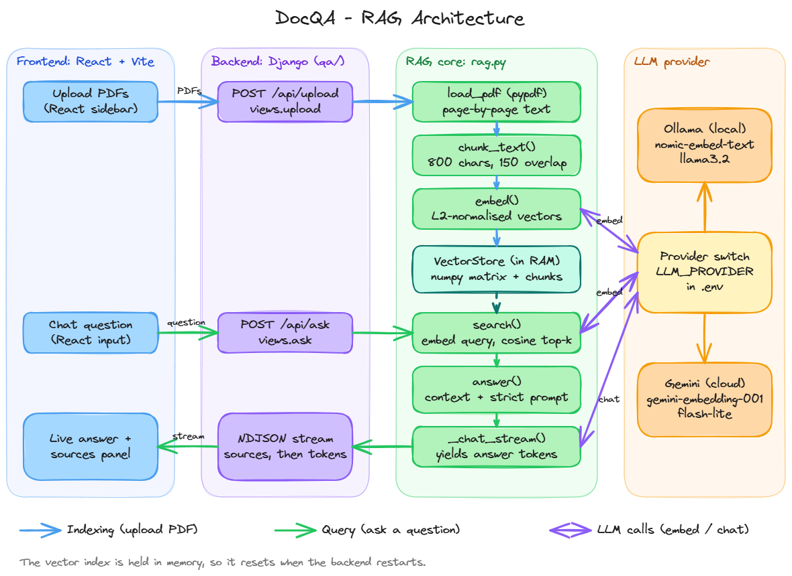

# Document Q&A (RAG)

Upload PDFs and ask questions about them in plain English. Answers come only from the documents, with page citations, and the app says "I don't know" when the answer isn't there.

It runs fully locally with Ollama, or with Google Gemini in the cloud. Switch with one environment variable.

**Stack:** React (Vite), Django, numpy, Ollama (`llama3.2`, `nomic-embed-text`) or Gemini

## How it works

The editable source is `docs/architecture.excalidraw` (open it at excalidraw.com).

- Chunks overlap so a sentence that falls on a boundary can still be retrieved.
- Vectors are normalised, so a dot product is cosine similarity and search is one matrix multiply. That is fine for thousands of chunks.
- The prompt tells the model to answer only from the numbered context and to cite `[1]`, `[2]`, which keeps hallucinations down.
- Answers are streamed as NDJSON: a `sources` line first, then `token` lines.

## Evaluation

`python eval.py` runs 15 questions (each with its expected page) against `samples/company_policy.pdf`, a fictional 8-page policy manual.

| Provider | Right page in top 4 | Right page is #1 | Correct answer |
|---|---|---|---|
| Ollama (`nomic-embed-text` + `llama3.2`) | 15/15 | 14/15 | 15/15 |
| Gemini (`gemini-embedding-001` + flash-lite) | 15/15 | n/a | 15/15 |

`python eval.py --sweep -k 1` compares chunk sizes. With Ollama, 200-character chunks got every top-1 right, while 400 to 1500 characters missed one question. It's a small synthetic document, so this is a sanity check and not a benchmark.

## Run locally

1. Install [Ollama](https://ollama.com/download), then `ollama pull llama3.2` and `ollama pull nomic-embed-text`
2. `pip install -r requirements.txt`
3. Copy `.env.example` to `.env` (default provider is `ollama`)
4. Backend: `python manage.py runserver 8000`
5. Frontend (second terminal): `cd frontend`, `npm install`, `npm run dev`, open http://localhost:5173

To use Gemini, put a key in `.env` (`GEMINI_API_KEY=...`) and set `LLM_PROVIDER=gemini`. Free keys: https://aistudio.google.com/apikey

Tests: `python -m pytest` for unit tests, `python e2e_check.py` to push a real PDF through the HTTP endpoints.

## Deploy

Everything is configured through environment variables.

- **Backend:** `LLM_PROVIDER`, `GEMINI_API_KEY`, `DJANGO_SECRET_KEY`, `DJANGO_DEBUG=false`, `DJANGO_ALLOWED_HOSTS` and `CORS_ALLOWED_ORIGINS` (the frontend URL).
- **Frontend** (`frontend/`): `VITE_API_URL` set to the backend URL.

The index is held in memory, so it resets whenever the backend process restarts. Re-upload your PDF after that.

## Limitations

- Scanned PDFs need OCR, which isn't included.
- The index lives in memory: no persistence and no separation between users.
- Possible next steps: pgvector for storage, reranking, hybrid BM25 + vector search, and conversation memory.
